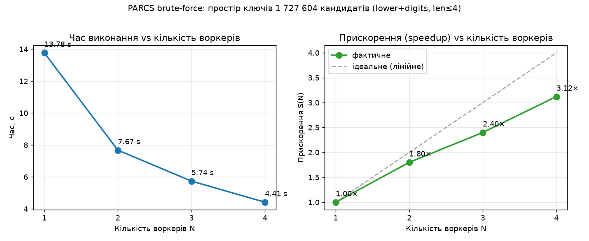

# Лабораторна робота 1 — Хмарні обчислення

**Тема:** Паралельний brute-force для відновлення пароля (варіант 7.6)
**Платформа паралельних обчислень:** PARCS-Python
**Хмара:** Google Cloud Platform (Compute Engine)
**Автор:** Юлія Частухіна

---

## 1. Ідея алгоритму (коротко)

Задача — відновити пароль, знаючи лише його хеш, повним перебором простору ключів.

**Простір ключів** — усі рядки над заданим алфавітом `charset` довжиною від 1 до `maxlen`.
Кожному кандидату відповідає свій глобальний індекс `0 … total−1`, де

```
total = Σ (|charset|^L),  L = 1 … maxlen
```

Функція `index_to_candidate(i)` однозначно перетворює індекс у рядок (позиційна система
числення за основою `|charset|`), тому весь простір можна адресувати одним цілим числом.

**Розпаралелювання (scatter → map → reduce):**

1. **scatter (master).** Майстер ділить відрізок `[0, total)` на `N` рівних неперервних
   діапазонів — по одному на воркер.
2. **map (worker).** Кожен воркер незалежно перебирає свій діапазон: для кандидата рахує
   «повільний» хеш (SHA-256 із key-stretching, що імітує PBKDF2/bcrypt) і порівнює з цільовим.
   Воркери не обмінюються даними між собою — ідеально паралельна задача (embarrassingly parallel).
3. **reduce (master).** Майстер збирає результати воркерів і повертає перший непорожній —
   знайдений пароль; пише його в `output.txt`.

Оскільки діапазони не перетинаються і покривають весь простір, збільшення кількості воркерів
майже лінійно зменшує час (кожен обробляє у `N` разів менше кандидатів).

Код джоби — [`solver.py`](solver.py) (клас `Solver`: `solve()` на майстрі, `@expose`-методи
`mymap`/`myreduce` на воркерах — стандартний шаблон PARCS-Python).

---

## 2. Демонстрація нод (master + 4 workers)

Кластер піднімається одним файлом [`docker-compose.yml`](docker-compose.yml): сервіс `master`
(піднімає Pyro4 nameserver і запускає джобу) та сервіс `worker` з 4 репліками.

```bash
docker compose up --build
docker compose ps
```

```
NAME                     ROLE     STATUS
parcs-master-1           master   Up      (Pyro4 nameserver :9090, job runner)
parcs-worker-1           worker   Up      (registered @ master)
parcs-worker-2           worker   Up      (registered @ master)
parcs-worker-3           worker   Up      (registered @ master)
parcs-worker-4           worker   Up      (registered @ master)
```

У логах майстра видно роздачу діапазонів:

```
[master] Job started
[master] Workers: 4
Worker 0 -> range [0, 431901)
Worker 1 -> range [431901, 863802)
Worker 2 -> range [863802, 1295703)
Worker 3 -> range [1295703, 1727604)
Result: help
```

---

## 3. Запуск на різній кількості воркерів (N = 1, 2, 3, 4)

Кількість воркерів задається масштабуванням сервісу:

```bash
N=1 docker compose up --build --scale worker=1 --abort-on-container-exit   # N = 1
N=2 docker compose up --scale worker=2 --abort-on-container-exit           # N = 2
N=3 docker compose up --scale worker=3 --abort-on-container-exit           # N = 3
N=4 docker compose up --scale worker=4 --abort-on-container-exit           # N = 4
```

(змінна `N` виставляє `EXPECTED_WORKERS`, щоб майстер дочекався саме стількох воркерів.)

Після кожного запуску результат з’являється в `output.txt`:

```
PASSWORD FOUND: help
```

Вимірювання часу для таблиці/графіка виконано ідентичним за логікою
бенчмарком [`benchmark/bruteforce_mp.py`](benchmark/bruteforce_mp.py) (той самий поділ простору
ключів, та сама хеш-функція), щоб числа були чистими й відтворюваними на одній машині:

```bash
cd benchmark && ./run_benchmark.sh
```

---

## 4. Build-помилки PARCS-модуля та їх виправлення

PARCS-Python написаний під Python 2.7, тому «з коробки» на сучасній системі збірка падала.
Що саме чинили:

| Проблема | Причина | Фікс |
|---|---|---|
| `pip install Pyro4` падає: `serpent (1.30.x) doesn't support this obsolete Python version 2.7` | Pyro4 тягне залежність `serpent>=1.27`, а резолвер pip хапає найновіший `serpent`, який з версії **1.30 прибрав підтримку Python 2.7** (`setup.py` кидає `RuntimeError`) | ставимо **`serpent==1.28`** (остання з підтримкою py2.7) **першою**, і лише потім `Pyro4==4.77` — тоді залежність уже задоволена сумісною версією |
| `Pyro4` падає на серіалізації / `SerializeError` між нодами | у нових версіях змінився стандартний серіалізатор | явно `PYRO_SERIALIZER=serpent`, `PYRO_SERIALIZERS_ACCEPTED=serpent,json,pickle` (і в env, і в коді нод) |
| воркери не бачать nameserver / `NamingError` | воркери стартують раніше за майстра | в `entrypoint.sh` воркер чекає на nameserver у циклі `until Pyro4.locateNS(...)` |
| `print "..."` / `xrange` синтаксичні помилки | випадковий запуск під Python 3 | фіксована база Python 2.7 у Dockerfile; увесь код джоби сумісний з py2 |

Усі фікси зафіксовані в [`Dockerfile`](Dockerfile) та [`entrypoint.sh`](entrypoint.sh), тож
кластер відтворюється однією командою без ручного налаштування.

---

## 5. Гайд з налаштування хмарного сервісу (GCP) — мінімально достатній

Щоб колеги могли підняти пайплайн з нуля на **Google Cloud Compute Engine**:

```bash
# 0. Встановити та ініціалізувати gcloud CLI, обрати проєкт
gcloud init
gcloud config set project <PROJECT_ID>

# 1. Створити VM (Ubuntu 22.04, 4 vCPU — щоб було видно масштабування до 4 воркерів)
gcloud compute instances create parcs-vm \
    --zone=europe-central2-a \
    --machine-type=e2-standard-4 \
    --image-family=ubuntu-2204-lts \
    --image-project=ubuntu-os-cloud \
    --boot-disk-size=20GB

# 2. Відкрити порт Pyro4 nameserver (лише якщо ноди на різних VM; для одного VM не треба)
gcloud compute firewall-rules create parcs-pyro \
    --allow=tcp:9090 --target-tags=parcs --direction=INGRESS

# 3. Зайти на VM
gcloud compute ssh parcs-vm --zone=europe-central2-a

# --- далі всередині VM ---

# 4. Встановити Docker + compose
sudo apt-get update && sudo apt-get install -y docker.io docker-compose-plugin git
sudo usermod -aG docker $USER && newgrp docker

# 5. Забрати код і підняти кластер
git clone https://github.com/<YOUR_USERNAME>/cloud-computing-labs.git
cd cloud-computing-labs/lab1-parcs-bruteforce
docker compose up --build --scale worker=4

# 6. Результат
cat output.txt           # PASSWORD FOUND: help

# 7. Після роботи — прибрати VM, щоб не витрачати кредити
gcloud compute instances delete parcs-vm --zone=europe-central2-a
```

> Для бенчмарку: `cd benchmark && ./run_benchmark.sh` → `results.csv`, `results.png`.

---

## 6. Результати

### Таблиця: час виконання vs кількість воркерів

Простір ключів — **1 727 604** кандидати (`charset = a–z0–9`, `maxlen = 4`), пароль `help`.

| Воркерів N | Час, с | Прискорення S(N) | Ефективність S(N)/N |
|:---:|:---:|:---:|:---:|
| 1 | 13.775 | 1.00× | 100% |
| 2 | 7.674  | 1.80× | 90%  |
| 3 | 5.737  | 2.40× | 80%  |
| 4 | 4.414  | 3.12× | 78%  |

### Графік



**Висновок.** Зі збільшенням кількості воркерів час майже лінійно спадає (13.8 с → 4.4 с).
Прискорення на 4 воркерах — **3.12×**; відхилення від ідеального лінійного пояснюється
накладними витратами (старт процесів, розсилка діапазонів, збірка результатів) та спільними
ресурсами CPU — класична ілюстрація закону Амдала.

---

## 7. Посилання на GitHub

**Репозиторій з кодом:** https://github.com/<YOUR_USERNAME>/cloud-computing-labs

> Замінити `<YOUR_USERNAME>` на свій логін після `git push`.
